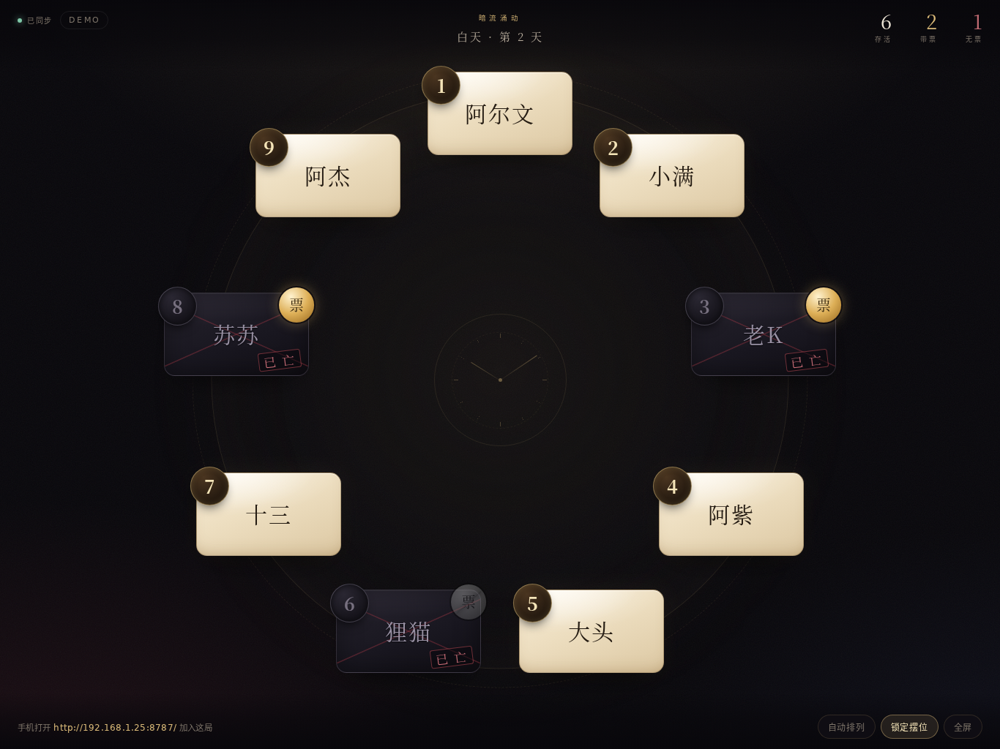
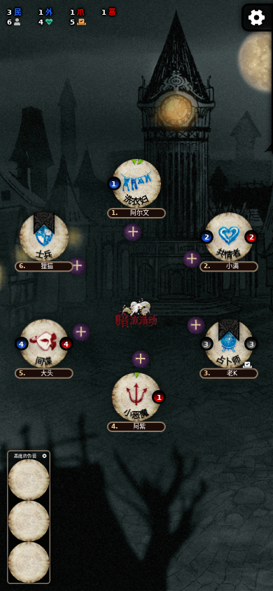

# 血染钟楼 · 桌面同步

线下开团用的小工具：**平板当「城镇广场」，手机当「魔典」**。
手机上标记「已亡 / 已亡·带票 / 已亡·无票」，平板上的名牌立刻盖血印、换票面，不用再喊。

手机端直接用《染·钟楼谜团》**官方魔典本体**（本地托管一份，断网也能用），界面和操作一模一样。

零依赖，一个 Node 文件跑起来；两台设备连同一个 Wi-Fi 就能用。



## 快速开始

需要 Node 18 或更新版本。

```bash
cd clocktower-table
node server.js
```

终端会打印地址：

```
本机      http://localhost:8787/
加密      https://localhost:8443/       （自签名证书）
局域网    https://192.168.x.x:8443/     ← 平板和手机都用这个
```

默认同时开 HTTP（8787）和 HTTPS（8443）。**手机上优先用 HTTPS 那个**：
很多安卓浏览器默认禁止明文 HTTP，会报 `ERR_CLEARTEXT_NOT_PERMITTED`。
自签名证书第一次打开会提示不安全，点「高级 → 继续前往」就好，之后就能正常用。

端口默认 8787，被占用会自动顺延；也可以手动指定：

```bash
node server.js --port 9000
```

## 两台设备怎么连

1. 平板浏览器打开 **局域网地址** → 点「城镇广场」（没有房间会自动建一个）
2. 手机浏览器打开 **同一个地址** → 点「魔典」（只有一个房间时会直接进入）
3. 手机上是官方魔典，按 `A` 或点座位间的「＋」加座位，填名字、点角色

> 地址建议存成书签。手机地址长这样：`.../gs/index.html?room=DEMO`，平板是 `.../square.html#DEMO`，`room=` 后面就是 4 位房间码。

## 手机 · 魔典

手机端用的是**官方魔典本体**——整套托管在 `public/gs/`，角色表也从官方接口缓存到了本地，断网照样能开。界面、操作、快捷键和 clocktower.gstonegames.com/grimoire 完全一致。



我在里面加了一层很薄的桥（`public/gs-bridge.js`）：读它的 Vuex 状态，把「座位 / 名字 / 角色 / 生死 / 鬼票」整份快照推给本地服务，平板端就能实时跟着变。

**在官方界面里怎么操作：**

- 按 `A` 加座位；触屏设备右下角有「＋ 座位」小按钮（官方网页版只有键盘快捷键，这个是我补的）
- 点角色托盘里的角色 → 点座位，分配身份（角色表用本地缓存，离线可用）
- **点杯子顶部**盖黑纱：存活 → 已亡 · 带票 → 已亡 · 无票 → 复活
- 右上角 ⚙ 是官方菜单：白天 / 夜晚、角色能力表 `R`、夜晚顺序表 `N`

> 官方魔典把状态存在浏览器的 localStorage 里。换手机或清缓存会从空桌子开始；平板那边保留的是最后一次同步的快照。

### 备用魔典

`/grimoire.html` 还留着我上一版做的轻量魔典（深色、列表式、专为单手操作，带「遮住身份」）。官方版在某些手机上不好点的时候可以直接用它，两边是同一个房间、同一份状态。

## 直连官方线上房间（可选）

官方魔典的「创建小镇」是一个 WebSocket 中继：主持人在 `<房间>/host`，旁观者连进同一条频道就能拿到状态。
所以平板也可以**不经过手机桥接**，直接旁观官方房间：

1. 手机打开官方魔典（线上原站，或本机 `/gs/`），按 `C`「创建小镇」起个房间名（≤10 个字符）
2. 平板打开城镇广场 → 右下角点「<b>官方房间</b>」→ 输入这个名字
3. 左上角出现绿色房间名就通了；主持人每次改动都会实时同步过来

也可以直接把房间名写进地址：`.../square.html?watch=房间名#房间码`，刷新会自动重连。

> 这个模式要求服务端和手机都能上外网（房间状态走官方服务器）。断网时用上面的本地桥接模式。

## 平板 · 城镇广场

- 只显示**公开信息**：座位号、名字、存亡、是否还有鬼票（不显示身份，不会剧透）
- **死亡**：牌子变暗、划上血痕、盖上「已亡」印章，并有一次震动式的高亮
- **带票**：右上角金色「票」；**无票**：灰色被划掉的「票」
- **拖动名牌**：随手摆成你们那张桌子的样子，位置会保存下来
- **锁定摆位**：防止有人趴桌子压歪
- **自动排列**：按座位号重新围成一圈
- 人数 5～15 人时名牌会自动缩放，不会叠在一起
- **全屏**：放桌上更像一块牌桌

## 数据与重置

- 每个房间自动存到 `data/rooms/<房间码>.json`，服务重启后自动恢复
- 想全部重来：停掉服务，删掉 `data/rooms/` 里的文件，再启动
- 另一台设备打开空的官方魔典时，空快照会被忽略，不会把桌上已有的牌冲掉
- 手机端「⚙ → 清空本局」只清当前房间

## 素材与来源

手机端的整页应用（`public/gs/`）是从官方魔典 clocktower.gstonegames.com/grimoire 镜像下来的，角色表缓存自官方接口（`public/ct-role-data.json`）。
只用于你自己的线下开团，别公开分发。介意的话把手机端换成 `public/grimoire.html`（自己做的备用版）就行。

## 常见问题

**手机提示「网页无法打开 / ERR_CLEARTEXT_NOT_PERMITTED」？**
用 HTTPS 地址（`https://192.168.x.x:8443/`），点「高级 → 继续前往」。
不想每次点警告的话，也可以把浏览器的「始终使用安全连接 / HTTPS 优先」关掉，再用 `http://192.168.x.x:8787/`。

**手机打不开？**
确认两台设备在同一个 Wi-Fi；用局域网 IP（`192.168.x.x`）而不是 `localhost`；电脑防火墙放行 8787 端口。

**房间页提示「这个房间不存在了」？**
房间被清空或服务换了数据目录，回首页重新开一局即可。

**平板会自动锁屏？**
网页的屏幕常亮（Wake Lock）只在 HTTPS 或 localhost 下生效，局域网 http 下可能拿不到。把平板的自动锁屏时间调长，或插着电开「充电时不锁屏」。

**安全吗？**
这是纯局域网工具，没有登录、没有加密。别把端口映射到公网。

## 技术说明

- 后端：Node 内置 `http`，**零第三方依赖**
- 同步：浏览器 `EventSource`（SSE）推全量快照 + `POST /api/room/:code/intent` 写入
- 手机端乐观更新：先本地应用意图，收到服务器回执后再对齐，连续点击不会回跳
- 断线自动重连；后台切回前台会补拉一次状态
- 状态写入防抖 180ms 落盘（原子写：先写 `.tmp` 再 rename）

主要文件：

```
server.js                 HTTP + SSE + 房间存储
public/index.html         启动页（选设备、看局域网地址）
public/square.html        平板 · 城镇广场
public/gs/                官方魔典（本地托管，含素材）
public/gs-bridge.js       官方魔典 → 房间状态的桥
public/ct-role-data.json  官方角色表缓存
public/grimoire.html      备用轻量魔典
public/js/model.js        共享数据模型（服务端/浏览器同一份）
public/js/store.js        客户端状态仓库（乐观更新 + 回执校准）
public/js/square.js       环形排布、拖动摆位、死亡动画
public/js/grimoire.js     玩家列表、身份选择、状态标记
public/js/characters.js   角色数据（暗流涌动）
```

## 后续可以加

- **角色立绘**：现在用文字代替。角色块已经带了 `data-char="角色id"`，把图片塞进 `.chip` 背景即可
- **二维码**：平板直接显示二维码，手机扫一下就进来
- **更多剧本 / 旅行者**：往 `characters.js` 里加数据即可，界面会自动分组
- **提名与投票**：加一轮提名流程，把票数也同步到广场
